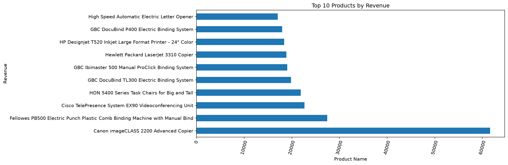
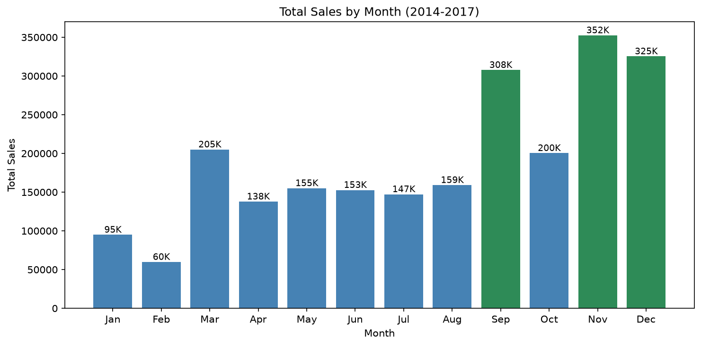
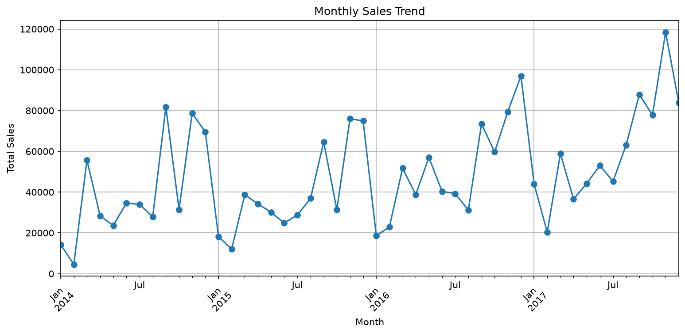
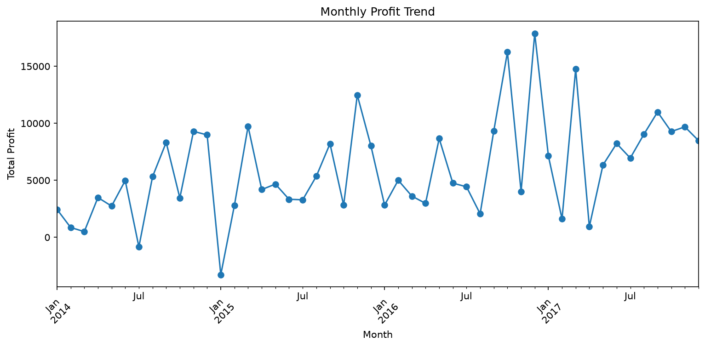
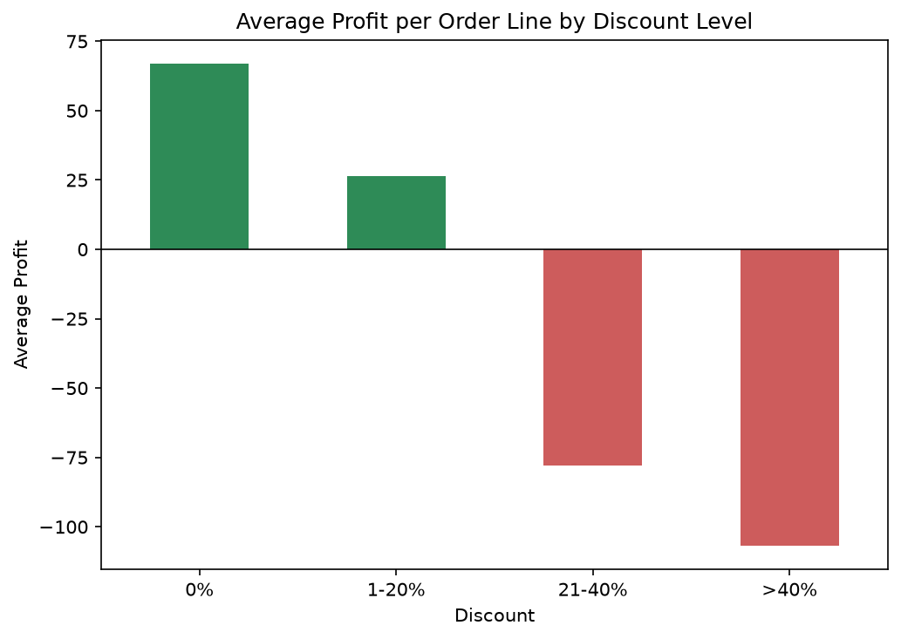
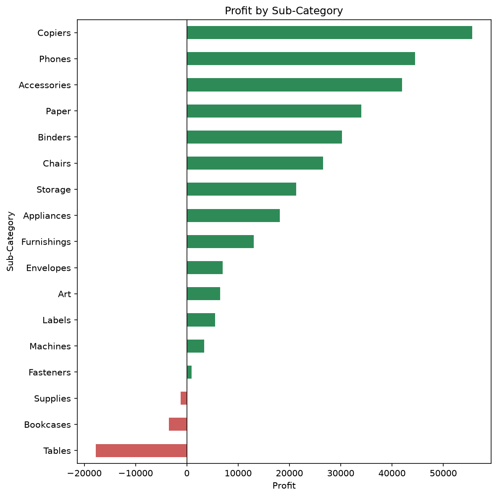

# 🛒 E-commerce Sales Data Analysis


### Turning Retail Data into Business Insights

An end-to-end data analytics project using Python, Pandas, SQL and data visualization.
## 📑 Table of Contents

- [Objective](#objective)
- [Dataset](#dataset)
- [Tools and Technologies](#tools-and-technologies)
- [Project Structure](#project-structure)
- [Methodology](#methodology)
- [Key Findings](#key-findings)
- [Recommendations](#recommendations)
- [Limitations](#limitations)
- [How to Run](#how-to-run)
- [Author](#author)
## Objective

1. Which products generate the highest revenue?
2. Which months have the highest sales?
3. Which regions perform best?
4. What are the sales and profit trends?

## Dataset

- **Source:** Sample Superstore dataset (Kaggle)
- **Size:** 9,994 rows and 21 columns
- **Period covered:** 3 January 2014 to 30 December 2017
- **Key columns:** Order Date, Region, Category, Sub-Category, Product Name, Sales, Quantity, Discount, Profit

## Tools and Technologies

- Python 3 (Anaconda distribution)
- Pandas and NumPy for data cleaning and analysis
- Matplotlib and Seaborn for visualization
- SQLite (via Python's `sqlite3`) for SQL queries
- Jupyter Notebook

## Project Structure

```
project/
├── data/               # raw CSV (superstore.csv) and SQLite database (ecommerce.db)
├── notebooks/          # analysis notebook
├── sql/                # queries.sql with the SQL for all four questions
├── visualizations/     # saved charts (PNG)
├── reports/            # final report and HTML export of the notebook
└── README.md
```

## Methodology

1. **Data inspection and cleaning:** checked data types, missing values and duplicate rows. No missing values or duplicate rows were found. Converted `Order Date` to a datetime type.
2. **Analysis in Pandas:** grouped sales and profit by product, month and region, and plotted the results.
3. **Analysis in SQL:** loaded the data into SQLite and wrote equivalent queries for each question (see `sql/queries.sql`).
4. **Validation:** compared the SQL results with the Pandas results to confirm they match.

## Key Findings

**Overall:** total sales of **$2,297,200.86**, total profit of **$286,397.02**, and an overall profit margin of **12.47%**.

### 1. Top products by revenue

The highest-earning product is the **Canon imageCLASS 2200 Advanced Copier** with about **$61,600** in sales, more than double the second-placed product. Office machines and equipment (copiers, binding machines, printers, videoconferencing) dominate the top 10.

| Rank | Product | Sales |
|---|---|---|
| 1 | Canon imageCLASS 2200 Advanced Copier | $61,599.82 |
| 2 | Fellowes PB500 Electric Punch Plastic Comb Binding Machine | $27,453.38 |
| 3 | Cisco TelePresence System EX90 Videoconferencing Unit | $22,638.48 |
| 4 | HON 5400 Series Task Chairs for Big and Tall | $21,870.58 |
| 5 | GBC DocuBind TL300 Electric Binding System | $19,823.48 |



### 2. Highest sales months

**November ($352,461), December ($325,294) and September ($307,650)** are the strongest months, and these three months rank in the top three in every year from 2014 to 2017. **January ($94,925) and February ($59,751)** are the weakest. The pattern points to holiday-season demand and a September peak, followed by a post-holiday slump.



### 3. Regional performance

| Region | Sales | Profit | Profit margin |
|---|---|---|---|
| West | $725,457.82 | $108,418.45 | 14.94% |
| East | $678,781.24 | $91,522.78 | 13.48% |
| Central | $501,239.89 | $39,706.36 | 7.92% |
| South | $391,721.90 | $46,749.43 | 11.93% |

The **West** is the best performer on sales, profit and margin. The **Central** region has the second-lowest sales of the four but the weakest profit and by far the lowest margin (7.92%), which points to heavy discounting or low-margin products there.


### 4. Sales and profit trends

| Year | Sales | Profit | Margin |
|---|---|---|---|
| 2014 | $484,247.50 | $49,543.97 | 10.2% |
| 2015 | $470,532.51 | $61,618.60 | 13.1% |
| 2016 | $609,205.60 | $81,795.17 | 13.4% |
| 2017 | $733,215.26 | $93,439.27 | 12.7% |

- Sales dipped slightly in 2015, then grew each year, rising about 51% from 2014 to 2017.
- Profit grew faster than sales over the period (about 89%), mainly because margin improved from 10.2% in 2014 to around 13% afterwards.
- Monthly profit is volatile. The largest monthly loss was in January 2015 (about -$3,281).
- A mild negative correlation (-0.22) between discount and profit suggests that higher discounts tend to reduce profit.




## Deeper Insights

### Discounts and profit
There is a mild negative correlation (-0.22) between discount and profit. Grouping order lines by discount level shows where it turns harmful: discounts above 20% lose money on average.

| Discount level | Average profit per order line |
|---|---|
| 0% | $66.90 |
| 1-20% | $26.50 |
| 21-40% | -$77.86 |
| Above 40% | -$106.71 |



### Profit by sub-category
Three sub-categories lose money overall: **Tables (about -$17,725)**, **Bookcases (about -$3,473)** and **Supplies (about -$1,189)**. The most profitable are **Copiers (about $55,618)**, **Phones (about $44,516)** and **Accessories (about $41,937)**. By category, Technology ($145,455) and Office Supplies ($122,491) earn most of the profit, while Furniture makes only $18,451 on $741,999 in sales, a margin of about 2.5%.



### Products that lose money
The biggest losses come from the **Cubify CubeX 3D Printer (Double Head Print)** at about -$8,880 and the **Lexmark MX611dhe Monochrome Laser Printer** at about -$4,590.

## Recommendations

- Cap discounts at around 20%, since deeper discounts lead to losses on average.
- Review pricing and discounting on **Tables and Bookcases**, which lose money despite high sales.
- Build inventory and run campaigns ahead of **September to December**, and consider promotions in January and February to lift the slow months.
- Investigate the **Central** region's discounting and product mix, since its margin is far below the West and East.
- Review discount levels on products that sell well but lose money, because higher discounts are linked to lower profit.
- Keep promoting high-revenue equipment lines (copiers, binding machines, printers) that drive a large share of sales.

## Limitations

- Based on a single dataset with no customer-level behaviour or marketing data.
- Monthly totals combine four years, so one unusually strong year can influence the ranking (though the top months are consistent across years).
- Sales and profit are in the dataset's original currency, with no adjustment for inflation.
- Correlation between discount and profit does not prove that discounts cause lower profit.

## How to Run

1. Clone or download this repository.
2. Install the requirements: `pip install pandas numpy matplotlib seaborn notebook`
3. Place `superstore.csv` in the `data/` folder.
4. Open `notebooks/analysis.ipynb` in Jupyter Notebook.
5. In the first cell, set `BASE` to the path of your project folder.
6. Run all cells from top to bottom (**Kernel → Restart & Run All**).

Charts are saved to `visualizations/`, the SQLite database to `data/ecommerce.db`, and the SQL queries to `sql/queries.sql`.

## Author

**Dhruv Rajpurohit**

BSc Data Science Student

- LinkedIn: [Connect with me](https://linkedin.com/in/dhruv-rajpurohit-622836359/)
- GitHub: [View my repositories](https://github.com/dhruv64termux)
